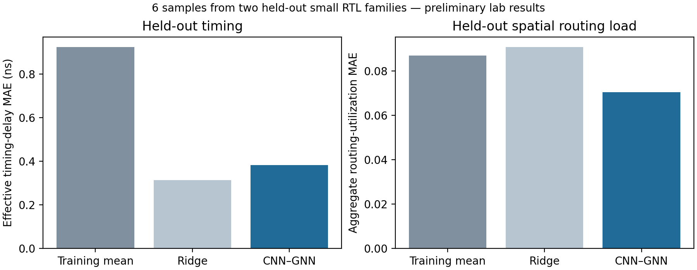
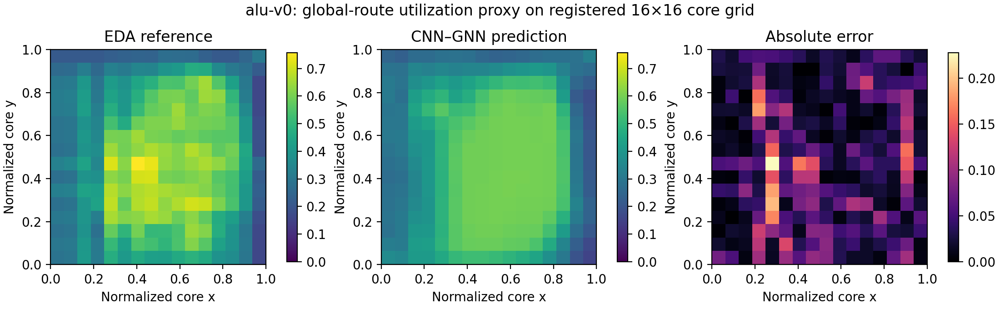
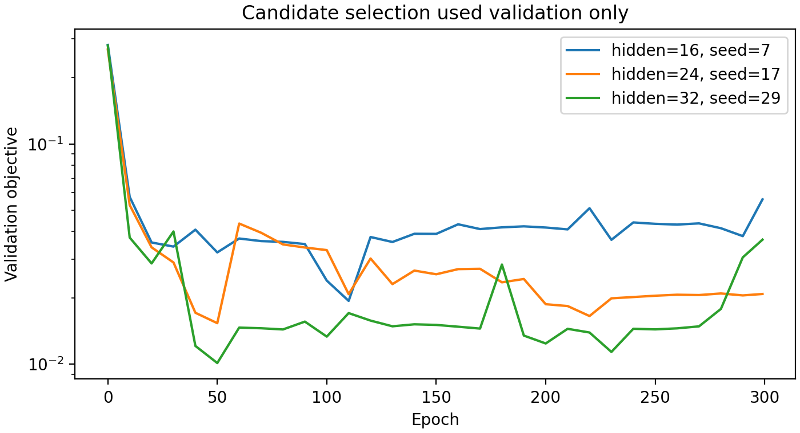

# Laboratory experiment — 3 November 2026

This report records a restricted CNN–GNN laboratory prototype, a candidate for
TRL 4 assessment. Institutional/independent assessment remains pending.

- 18/18 actual Sky130HD EDA runs from six original design families.
- Family-separated splits: 9 training, 3 validation and 6 held-out samples.
- Three 300-epoch-budget candidates; validation selected hidden size 32,
  seed 29, epoch 50. No held-out-driven retuning.
- 16 repository tests passed. Trained-checkpoint CLI, direct inference and real
  local HTTP predictions agreed; invalid requests were rejected.
- 2,199 raw EDA artifact hashes verified in the cloud experiment.

| Held-out MAE, lower is better | Training mean | Ridge | CNN–GNN |
|---|---:|---:|---:|
| Effective timing delay (ns) | 0.9235 | **0.3127** | 0.3822 |
| Aggregate routing utilization | 0.08700 | 0.09078 | **0.07038** |

Ridge remains the better timing predictor. Only two small families are held out;
these results do not establish broad generalization, calibrated uncertainty,
industrial sign-off, production readiness, or the wider packaging/DFT vision.

Machine-readable evidence: [evaluation](evaluation.json), [training](training.json),
[readiness](readiness.json), and [real-service check](service-check.json).
The JSON reports preserve the measured run and original source hashes. A later
Git commit packages these results; those hashes describe the experiment code.

The complete raw artifacts, dataset, checkpoint and checksums remain in the
published cloud workspace at `/workspace/experiments/trl4-lab-20261103`.
Generated EDA files and model weights are excluded from this source commit.
To reproduce, follow the [lab guide](../../docs/lab_validation.md).
